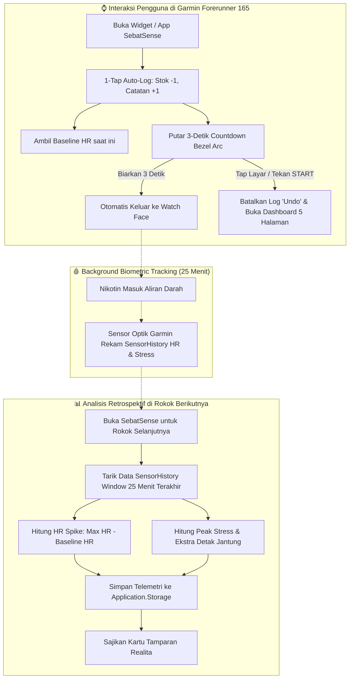

<div align="center">


# 🚬 SebatSense
### *Cigarette Tracker & Biometric Reality-Slap Telemetry*

**Garmin Connect IQ Watch App** untuk **Forerunner 165** (390×390 AMOLED)

[](https://developer.garmin.com/connect-iq/sdk/)
[](https://www.garmin.com/en-US/p/735520)
[](https://developer.garmin.com/connect-iq/reference-guides/devices-reference/)
[](https://github.com/NaufalFahrozi/SebatSense/releases)
[](https://developer.garmin.com/connect-iq/api-docs/)
[](https://developer.garmin.com/connect-iq/monkey-c/)
[](LICENSE)

*"Sekali hisap, realita bicara."*

</div>

---

## ✨ Tentang SebatSense

**SebatSense** adalah aplikasi Garmin yang dirancang dengan filosofi **zero-friction** — catat rokok cukup dengan **1 ketukan**, lalu jam tangan **otomatis menutup sendiri dalam 3 detik**. Tidak ada form, tidak ada tombol konfirmasi berbelit-belit. Cepat, instan, dan alami.

Yang membedakan SebatSense dari tracker rokok biasa adalah **Biometric Reality-Slap**. Setiap kali kamu mencatat rokok baru, aplikasi secara retrospektif menganalisis sensor jam tangan Garmin dari 25 menit setelah rokok *sebelumnya* dan menyajikan dampak nyata ke tubuhmu:
- 📈 **HR Spike**: Berapa bpm denyut nadi terpaksa melonjak.
- ⚡ **Peak Stress**: Berapa level stres puncak yang dialami sistem sarafmu.
- 💓 **Extra Beats**: Berapa ribu detak jantung ekstra yang terpaksa dipompa jantungmu.
- 💸 **Uang Terbakar**: Berapa rupiah yang sudah hangus terbakar hari ini dan bulan ini.

---

## 📸 Antarmuka Layar & Layout 390×390 AMOLED

### 1. 🔭 Glance View (Widget Sekilas di Watch Face)
```text
           ╭──────────────────────────────────────────────╮
           │ 🚬 SEBATSENSE          [Sisa: 14/16 btg]     │
           │ Hari ini: 2 batang     Terakhir: 42m lalu    │
           │ ━━━━━━━━━━━━━━━━━░░░░░  [CO Darah Tinggi]    │  <-- Recovery Bar
           │ Habis: ~19:40          Uang: Rp 4.500        │
           ╰──────────────────────────────────────────────╯
```

### 2. ⚡ Layar 1-Tap Auto-Log (3-Detik Bezel Countdown)
```text
                     ╭───────── 390×390 AMOLED ─────────╮
                     │         [ 14 / 16 ]              │  <-- Stok Berkurang Otomatis
                     │       BATANG HARI INI: #2        │
                     │                                  │
                     │    ╭────────────────────────╮    │
                     │    │  TAMPARAN REALITA      │    │  <-- Reality-Slap Card
                     │    │  HR Spike: +18 bpm     │    │
                     │    │  Peak Stress: 68/100   │    │
                     │    │  Ekstra: +540 detak    │    │
                     │    ╰────────────────────────╯    │
                     │                                  │
                     │        Tap / START = Batal       │  <-- Undo & Buka Dashboard
                     │  ━━━━━━━━━━━━━━━━━━━━━━━━━━━━━   │  <-- Outer 360° Countdown Arc Ring
                     ╰──────────────────────────────────╯
```

### 3. 📱 Dashboard Interaktif 5 Halaman Minimalis
Jika layar disentuh atau tombol **START** ditekan selama countdown 3 detik, pencatatan otomatis dibatalkan (**Undo**) dan kamu masuk ke **Dashboard 5 Halaman**:

```text
       [1. BIOMETRICS]      ➔      [2. REALITY-SLAP]     ➔     [3. SISA BUNGKUS]
   Live HR: 74 bpm (1s pulse)       HR Spike: +18 bpm           Sisa: 14/16 batang
   Fase: CO Darah Tinggi            Peak Stress: 68/100         Habis: ~19:40 (EMA)
   O2 Pulih: ~78m lagi              Ekstra: +540 detak          [Pill: Menu Aksi Stok]
                                           ⬇
                                   [5. PENGATURAN]       ⬅     [4. UANG TERBAKAR]
                                 Isi: 16 btg | Rp 36.000         Hari Ini: Rp 4.500
                                 Harga: Rp 2.250 / btg           Bulan Ini: Rp 72.000
                                 [Pill: Menu Pengaturan]         Total: 2 batang
```

---

## 💡 Kapan Waktu Terbaik Membuka Aplikasi?

> **Rekomendasi Utama: Buka jam tangan PAS mau bakar rokok (saat menyalakan korek / sebelum hisapan pertama).**

### 🔄 Alur Penggunaan Alami:
1. **Pas Mau Bakar Rokok**:
   - Ketuk widget **SebatSense** di jam tanganmu.
   - Jam tangan akan bergetar (*haptic pulse*), stok berkurang otomatis (`16/16` $\rightarrow$ `15/16`), dan jumlah batang hari ini bertambah (`Batang #1`).
   - Jam secara otomatis menangkap **denyut nadi normal kamu saat itu (*Baseline HR*)** tepat sebelum nikotin masuk ke aliran darah.
   - Layar countdown 3 detik berputar dan **otomatis menutup sendiri**. Tidak perlu menekan tombol selesai/back, langsung hisap rokokmu dengan santai!

2. **Saat Menghisap Rokok**:
   - Dalam hitungan detik setelah hisapan pertama, nikotin mulai memicu respons kardiovaskular.
   - Sensor optik Garmin di pergelangan tanganmu akan merekam data biometrik secara otomatis di latar belakang selama 25 menit ke depan (kenaikan denyut nadi & lonjakan stres).

3. **Pas Mau Merokok Batang Berikutnya**:
   - Saat kamu membuka SebatSense lagi untuk batang selanjutnya, app langsung menganalisis data sensor 25 menit setelah rokok sebelumnya dan menyajikan **Tamparan Realita**: seberapa tinggi denyut nadimu melonjak (*HR Spike*), level stres puncak, dan ekstra detak jantung akibat rokok tadi.

*(Bagaimana kalau lupa dan baru buka app setelah selesai merokok? Tetap aman! Stok dan rupiah tetap tercatat akurat, hanya saja baseline denyut nadi awal sudah terlanjur naik karena nikotin).*

---

## 🧠 Arsitektur & Alur Kerja Sistem



---

## 🩸 Fase Pemulihan Biologis (Biological Recovery Stages)

Setiap batang rokok memicu reaksi fisiologis bertahap. SebatSense memetakan fase ini secara real-time pada Glance View dan Halaman Biometrics:

| Fase Pemulihan | Interval Waktu | Warna | Dampak Fisiologis Tubuh |
| :--- | :--- | :---: | :--- |
| **🔴 HR & Tensi Naik** | `0 – 20 menit` | Merah | Nikotin memicu pelepasan adrenalin; denyut jantung & tekanan darah melonjak ke titik tertinggi. |
| **🟠 CO Darah Tinggi** | `20 – 120 menit` | Oranye | Karbon monoksida (CO) mengikat hemoglobin darah; tubuh berjuang menurunkan beban racun gas. |
| **🟢 O₂ & HR Pulih** | `> 120 menit` | Hijau | Kadar oksigen darah dan denyut jantung istirahat telah kembali ke level normal. |

> ⚠️ **Chain-Smoking Alert**: Jika kamu membuka aplikasi kurang dari 30 menit sejak rokok terakhir, SebatSense akan menampilkan busur merah berkedip disertai getaran triple berat (*haptic alert*) untuk mengingatkan beban ganda pada jantungmu!

---

## 🕹️ Skema Kontrol & Navigasi

### 👆 Layar Sentuh (Touchscreen)
- **Geser Atas / Kiri (Swipe Up / Left)**: Pindah ke halaman dashboard berikutnya.
- **Geser Bawah / Kanan (Swipe Down / Right)**: Pindah ke halaman dashboard sebelumnya.
- **Ketuk Tombol / Pill**:
  - Pada Halaman 3: Buka *Menu Aksi Stok* (`Catat Manual`, `Buka Bungkus Baru`, `Kurangi 1 Catatan`).
  - Pada Halaman 5: Buka *Menu Pengaturan* (`Ubah Isi Bungkus`, `Ubah Harga`, `Reset Hari Ini`).
- **Ketuk Layar Saat Countdown**: Membatalkan pencatatan (*Undo*) dan membuka dashboard.

### 🔘 Tombol Fisik Garmin
| Tombol | Posisi | Fungsi Saat Countdown | Fungsi di Dashboard |
| :--- | :--- | :--- | :--- |
| **START / ENTER** | Kanan Atas | Batal (*Undo*) & buka dashboard | Buka Menu Aksi / Menu Pengaturan |
| **DOWN** | Kiri Bawah | Batal & masuk Halaman 2 | Maju ke halaman berikutnya |
| **UP** | Kiri Tengah | Batal & masuk Halaman 5 | Mundur ke halaman sebelumnya |
| **BACK / LAP** | Kanan Bawah | Keluar dari aplikasi | Keluar dari aplikasi |

---

## 🧠 Rumus Matematis & Algoritma (Teknikal)

### 1. Algoritma Prediksi Stok Habis (EMA)
Interval antar rokok dihitung dengan **Exponential Moving Average** ($\alpha = 0.3$) untuk memberikan prediksi jam habis yang realistis dan adaptif terhadap kebiasaan merokok pengguna:

$$\text{EMA}_{\text{baru}} = \frac{(\text{EMA}_{\text{lama}} \times 7) + (\text{Interval}_{\text{baru}} \times 3)}{10}$$

*Filter noise:* Interval $< 5\text{ menit}$ (bukan rokok baru) atau $> 4\text{ jam}$ (jeda tidur malam) otomatis diabaikan agar tidak merusak prediksi waktu habis bungkus.

### 2. Analisis SensorHistory Window 25-Menit
$$\text{Window Analisis} = [\text{lastSmokeTime},\; \text{lastSmokeTime} + 1500\text{ detik}]$$
$$\text{HR Spike} = \max(\text{HR}_{\text{window}}) - \text{HR}_{\text{baseline}}$$
$$\text{Peak Stress} = \max(\text{Stress}_{\text{window}})$$

### 3. Estimasi Ekstra Detak Jantung
Beban ekstra yang dipaksakan nikotin pada otot jantung dihitung berdasarkan durasi takikardia 30 menit:

$$\text{Ekstra Detak per Batang} = \text{HR Spike} \times 30\text{ unit beban}$$

---

## 🗄️ Skema Penyimpanan (`Application.Storage`)

| Key | Tipe Data | Nilai Default | Keterangan |
| :--- | :--- | :---: | :--- |
| `packSize` | Number | 16 | Jumlah batang per bungkus (`12`, `16`, `20`) |
| `packPrice` | Number | 36.000 | Harga per bungkus aktif (Rupiah) |
| `packLeft` | Number | 16 | Sisa batang dalam bungkus saat ini |
| `todayCount` | Number | 0 | Akumulasi batang rokok hari ini |
| `monthCount` | Number | 0 | Akumulasi batang rokok bulan ini |
| `lastLogDay` | Number | 0 | Format `YYYYMMDD` untuk deteksi rollover harian |
| `lastLogMonth` | Number | 0 | Format bulan untuk deteksi rollover bulanan |
| `lastSmokeTime` | Number | 0 | Unix Epoch waktu rokok terakhir dinyalakan |
| `lastSmokeBaseHr` | Number | 75 | Denyut jantung baseline sesaat sebelum merokok |
| `avgIntervalSec` | Number | 5.400 | EMA interval antar rokok (detik) |
| `lastHrSpike` | Number | 0 | Lonjakan denyut jantung dari rokok sebelumnya |
| `lastPeakStress` | Number | 0 | Level stres tertinggi dari rokok sebelumnya (0–100) |
| `todayExtraBeats` | Number | 0 | Akumulasi ekstra denyut jantung hari ini |
| `previousStateSnapshot` | Dictionary | null | Buffer snapshot untuk fungsi 1-tap Undo |

---

## 📦 Cara Memasang ke Jam Tangan (Installation)

### Cara 1: Sideload Langsung via USB (Direkomendasikan)
1. Unduh binary executable resmi **[`SebatSense-fr165.prg`](https://github.com/NaufalFahrozi/SebatSense/releases/tag/v1.0.0)** dari rilis GitHub.
2. Sambungkan Garmin Forerunner 165 ke PC/Laptop menggunakan kabel charger USB bawaan.
3. Buka File Explorer komputer, arahkan ke drive jam Garmin:
   ```text
   GARMIN (Drive) -> GARMIN -> APPS
   ```
4. Salin (*copy*) file `SebatSense-fr165.prg` ke dalam folder `GARMIN/APPS/` tersebut.
5. Lepaskan (*safely eject*) jam tangan dari PC.
6. Aplikasi **SebatSense** langsung muncul di daftar Glance dan siap dipakai!

---

### Cara 2: Kompilasi Sendiri dari Source Code

Pastikan kamu memiliki [Garmin Connect IQ SDK](https://developer.garmin.com/connect-iq/sdk/) (4.2.0+) dan developer signing key.

```bash
# 1. Clone repositori ini
git clone https://github.com/NaufalFahrozi/SebatSense.git
cd SebatSense

# 2. Build file executable PRG untuk Forerunner 165
monkeyc -f monkey.jungle -o bin/SebatSense-fr165.prg -d fr165 -y developer_key -w

# 3. Build App Package (.iq) untuk rilis Connect IQ Store
monkeyc -e -f monkey.jungle -o bin/SebatSense.iq -y developer_key -w
```

Untuk menjalankan di Simulator:
```bash
# 1. Buka Connect IQ Simulator
simulator

# 2. Jalankan aplikasi pada Forerunner 165
monkeydo bin/SebatSense-fr165.prg fr165
```

---

## 📁 Struktur Direktori Repositori

```text
SebatSense/
├── .github/
│   ├── ISSUE_TEMPLATE/
│   │   ├── bug_report.md          # Template pelaporan bug
│   │   └── feature_request.md     # Template usulan fitur baru
│   └── PULL_REQUEST_TEMPLATE.md   # Template checklist kontribusi
├── resources/
│   ├── drawables/
│   │   ├── drawables.xml          # Deklarasi resource gambar launcher
│   │   └── launcher_icon.png      # Ikon launcher resolusi tinggi
│   └── strings/
│       └── strings.xml            # String identifikasi aplikasi
├── source/
│   ├── SebatApp.mc                # Entry point aplikasi (AppBase & getInitialView)
│   ├── SebatDataManager.mc        # (:glance) Layer model murni & analitik biometrik
│   ├── SebatDelegate.mc           # BehaviorDelegate (Swipe, Tap & Tombol)
│   ├── SebatGlanceView.mc         # (:glance) Tampilan strip widget sekilas
│   ├── SebatMenuDelegate.mc       # Menu modal interaktif (Aksi Stok & Pengaturan)
│   └── SebatView.mc               # Render countdown arc & dashboard 5 halaman
├── .gitignore                     # Proteksi secret key developer & output build
├── LICENSE                        # Lisensi open-source MIT
├── manifest.xml                   # Deklarasi izin & target perangkat Forerunner 165
├── monkey.jungle                   # Konfigurasi build compiler Connect IQ
└── README.md                      # Dokumentasi komprehensif repositori
```

---

## 🛠️ Spesifikasi Perangkat & Persyaratan

| Properti | Nilai / Spesifikasi |
| :--- | :--- |
| **Model Perangkat** | Garmin Forerunner 165 (`fr165`) |
| **Tipe Layar** | 390 × 390 AMOLED High-Color Circular Display |
| **Tipe Aplikasi** | Watch-App dengan Glance Support (`(:glance)`) |
| **Bahasa Pemrograman** | Monkey C (Strict Typechecked) |
| **Minimum API Level** | Connect IQ `4.2.0+` (SDK 9.2.0 kompatibel) |
| **Fitur Hardware** | Optical Heart Rate, Stress SensorHistory, Haptic Motor, AMOLED Touchscreen |

---

## 📄 Lisensi & Hak Cipta

Proyek ini dirilis di bawah lisensi open source **[MIT License](LICENSE)**.

```text
Copyright (c) 2026 Muhammad Naufal Fahrozi
```

Bebas digunakan, dipelajari, dan dikembangkan untuk membantu siapapun membangun kesadaran terhadap dampak rokok pada kesehatan kardiovaskular.

---

<div align="center">

**Dibuat dengan ❤️, ☕, dan 🚬 (yang sedang dikurangi)**<br>

*SebatSense — karena kesadaran adalah langkah pertama menuju hidup yang lebih sehat.*

</div>
